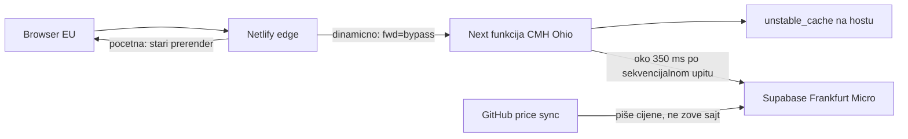
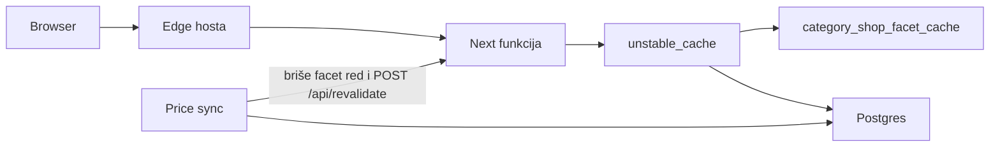

# TechZone — audit performansi i plan optimizacije

Datum mjerenja: 2026-11-24. Kod: HEAD repoa u tom trenutku (zadnji commit `26a6ce7`). Produkcijski deploy koji je mjeren je stariji: rute su još `/categories` i `/products`, ne `/kategorije` i `/proizvodi`.

Oznake u tekstu:

- **Izmjereno** — broj iz ovog audita (curl, `EXPLAIN`, `pg_stat_statements`, ili živi katalog).
- **Kod** — vidljivo u repou, sa putanjom.
- **Procjena** — nije ponovo izmjereno poslije izmjene; provjerava se protokolom `docs/performance/MEASUREMENT_PROTOCOL.md`.

Implementacija ne ide iz ovog fajla napamet. Tačne izmjene su u `docs/performance/`. Ovaj fajl objašnjava zašto su takve i šta se ne smije pomiješati.

---

## 1. Executive summary

Shop je Next.js 16.1.1 App Router na Netlifyju (funkcije u Ohiju, CMH). Baza je Supabase Postgres 17 u Frankfurtu, Micro compute (`shared_buffers` 224 MB, `max_connections` 60). Katalog ima 64.659 proizvoda, od toga 51.373 vidljiva, 72.675 ponuda, 265.041 atribut i 145.351 sliku.

Korisnik čeka iz tri razloga koji se sabiraju, a ne iz „nedostatka prefetcha“:

1. **Izmjereno.** Dinamične rute ne stoje na CDN-u (`Cache-Status: Netlify Durable fwd=bypass`). Prefetch vrati oko 9 KB loading shella. Klik i dalje čeka funkciju u Ohiju.
2. **Izmjereno.** Svaki sekvencijalni upit iz te funkcije prema Frankfurtu košta oko 350 ms. `/api/layout` (dva upita, bez data cachea) ima medijanu serverskog vremena 0,92 s. Isti PostgREST iz Evrope, na već otvorenoj vezi, odgovori za oko 60 ms.
3. **Izmjereno.** Nekoliko upita je skupo i kad mreža šuti: flash/featured čitaju cijelu tabelu 3,2 s jer nema nijednog takvog proizvoda a nema ni parcijalnog indeksa; facete `kucista` traju 1,2 s i na toplom kešu; početna HTML je servirana i 3,9 dana stara.

Posebno, **kod**: `createOrder` snima cijenu iz browsera. To se mora zatvoriti prije dužeg keša kataloga. Keš smije pokazati staru cijenu na sekunde ili minute. Narudžba ne smije.

`cacheComponents` / PPR je pravi mehanizam Next.js 16 da prefetch nosi sadržaj, ali na ovom kodu pali build (cookies, searchParams, `new Date()`, `export const revalidate`, `force-dynamic`). Zato nije u prvim fazama. Prvo se uklanjaju skupi upiti i dvostruki RSC, pa se keš može invalidirati poslije synca, pa tek onda prefetch ima šta da povuče.

iPon nije izmjeren. Ban od 24 h, a i raniji `curl`/browser/WebFetch iz ove sesije nisu dobili stranicu. Nema tvrdnji o njihovom CDN-u.

## 2. Pregled arhitekture

**Kod.** Shop rute žive u `src/app/(shop)/`: početna, `kategorije/[...slug]`, `proizvodi/[slug]`, `pretraga`. Root `src/app/layout.tsx` je server komponenta; `src/app/providers.tsx` je client i drži auth, wishlist, korpu, temu i `nextjs-toploader`. Shop chrome je `ShopLayout1`, podaci menija iz `getLayoutData` (`src/lib/layout-data.ts`).

Podaci kataloga idu kroz service role klijent (`src/utils/supabase.ts`), ne kroz cookie klijent. Zato `unstable_cache` smije obmotati te funkcije. Cookie klijent (`src/utils/supabase/server.ts`) koristi auth i nalog, ne listing.

Listing kategorije je RPC `get_category_products_listing` i `get_category_shop_facets` (`supabase/migrations/00053_category_listing_sql.sql`, tijelo potvrđeno i na živoj bazi). Pretraga ne zove `search_products`. Povlači redove PostgREST-om u blokovima od 1000 (`src/lib/search/search-listing.ts`).

Cijena na kartici je `getEffectivePrice(custom_price, price)` (`src/lib/effective-price.ts`). `products.price` je engine cijena iz agregatora. `custom_price` je ručni override prikaza. Korpa računa cijenu iz konkretnog offera (`resolveCartOfferPrices`) i override ne vidi. Narudžba vjeruje klijentu.

Sync cijena je GitHub Actions: `price-sync.yml` svaka 4 h, `nightly-pipeline.yml` u 20:30 UTC. Ne zovu Next revalidaciju.

`vercel.json` (`fra1`) se ne primjenjuje. Host je Netlify. Komentari u `src/middleware.ts` to već pominju.

## 3. Trenutni tok

Javne shop rute ne prolaze kroz Supabase auth u middlewareu (`src/middleware.ts` vraća `NextResponse.next()` kad putanja nije admin, nalog ili auth stranica). To je već urađeno i treba ostati.

## 4. Uska grla

| # | Usko grlo | Dokaz | Faza |
| --- | --- | --- | --- |
| 1 | Narudžba snima klijentsku cijenu | `orders-service.ts` oko 356–359 | 01 |
| 2 | Flash/featured seq scan 64.659 redova, 0 pogodaka, 3,2 s | `EXPLAIN` i `pg_stat_statements` mean 3,9 s, 200+ poziva | 03 |
| 3 | Facete `kucista` 1,2 s toplo; velika kategorija bez atributa 3,3 s hladno / 99 ms toplo | `EXPLAIN` | 06 |
| 4 | Dva listing RPC-a po otvaranju kategorije | `generateMetadata` zove `getCategoryProductsForPath`, page zove drugi ključ | 02 |
| 5 | Filter/sort rade `push` i `refresh` | `usePendingFilterNavigation.ts`, `category-products-section.tsx` | 02 |
| 6 | Layout meni nije u data cacheu, dva upita | `layout-data.ts` | 02 |
| 7 | Pretraga vuče sve pogodke | `ROW_PAGE_SIZE = 1000` petlja | 06 |
| 8 | CDN ne čuva dinamične HTML/RSC | `fwd=bypass` na kategoriji, proizvodu, pretrazi | 05 i 08, tek poslije 06 |
| 9 | Početna može ostati danima stara na Netlify Durable | `Age: 340260` uz `revalidate = 60` | 04, bez produženja TTL-a |
| 10 | `product_attributes` statistika prazna | `n_live_tup = 0`, `last_autoanalyze` null, stvarni count 265041 | 03 `ANALYZE` |
| 11 | Listing sort piše temp fajl | `work_mem` 2184 kB i `description` u CTE | 03 |
| 12 | Build ne prolazi | `alza/importProducts.ts:183` i `target: es5` | 00 |

Nisu uska grla: slug proizvoda (Index Scan, 2 ms), trigram indeksi (već postoje; jedan AND `ILIKE` plan je bitmap, 219 ms), RLS na katalogu (nema policy, nema policy troška), N+1 slika na PDP (ima indeks po `product_id`; faza 03 dodaje `sort_order` da se ne sortira iz heapa).

## 5. Izmjereno stanje

Serversko vrijeme je `TTFB - TLS`, sedam ili više ponavljanja, 2026-11-24, sa mreže u EU prema `techzoneba.netlify.app`.

| Cilj | Medijana serverskog vremena | Napomena |
| --- | --- | --- |
| Supabase REST iz EU, veza već otvorena | 0,06 s | 401 bez ključa, samo RTT do Frankfurta |
| CDN logo / JS chunk | 0,18–0,29 s | edge |
| `/api/homepage/service` bez baze | 0,21 s | funkcija, `Cache-Control: no-cache`, bypass |
| `/api/layout` dva upita | 0,92 s | min 0,67 s, max 1,88 s |
| `/api/homepage/categories` data cache 30 s | 0,57 s | i dalje bypass CDN-a |
| HTML `/` poslije revalidacije | 0,30 s | prije toga 5,5–6,5 s i Age 340260 s |
| HTML kategorije, proizvod, pretraga | 0,4–1,1 s | svi `fwd=bypass`; pojedini max 5,9 s |

Razlika layout minus funkcija bez baze je oko 0,71 s za dva sekvencijalna upita, dakle oko 0,35 s po hopu Ohio → Frankfurt. To je **izmjereno** kao razlika, ne kao traceroute. Apsolutni RTT Ohio–Frankfurt nije mjeren pingom.

Baza:

| Upit | Hladno | Toplo |
| --- | --- | --- |
| `is_flash_deal` limit 8, 0 redova | 3162 ms, seq scan, 17.841 buffera | nije ponovljen; `pg_stat_statements` mean 3891 ms |
| `is_featured` isto | mean 3839 ms, 204 poziva | isto |
| slug proizvoda | 2 ms, 4 buffera | isto |
| facete `foto-i-video-pribor` (6473 proizvoda, 0 atributa) | 3278 ms | 100 ms |
| facete `kucista` (1286 proizvoda, 20229 atributa) | 1194 ms, skoro sve hit | nije brže od toga; CPU/agg |
| listing `kucista` stranica 1 | 42 ms hit | |
| listing najveće kategorije sort cijene | 474 ms, `temp written=337` | 82 ms, temp i dalje |
| scan 6473 reda kategorije | 1,6 s uz read | 16 ms hit |

`pg_stat_statements` ukupno: update cijena i sync dominiraju zbirnim vremenom (milioni ms). Za shop su bitni flash/featured (mean ~3,9 s) i `get_category_products_listing` (2032 poziva, mean 361 ms) i facete (298 poziva, mean 1024 ms).

Lokalni `npm run build` nije dao tabelu ruta. Pao je na TypeScriptu prije toga (faza 00). Zato se za HEAD ne tvrdi koji su segmenti ISR.

## 6. Analiza po temama

### Prefetch

**Kod.** Nigdje nema `prefetch={false}` niti `router.prefetch`. Kartice koriste `next/link`. Paginacija i filteri koriste `router.push`, pa paginacija nema ni podrazumijevani prefetch. **Izmjereno** na starom deployu: prefetch dinamične rute je shell od ~9 KB.

Hover prefetch prije faze 06 povećava broj skupih facet upita. Na mobilnom hovera nema. Brzi scroll ne smije zakazati desetine RSC-ova. Zato prve faze ne dodaju ručni prefetch.

### Keš

Postoji `unstable_cache`: kategorije 30 s, listing i proizvod i pretraga 60 s, facete 300 s. Nema `use cache`, `cacheLife`, `cacheTag` direktive, niti `generateStaticParams`. React `cache()` deduplikuje dio poziva unutar jednog requesta, ne između korisnika.

`buildCategoryListingCacheKey` stavlja sve query parametre u ključ, uključujući `view` i marketing. To je **kod**.

Korpa, auth i wishlist nisu u tom kešu. Tako mora ostati. Service role u keširanim funkcijama je ok samo dok funkcija ne čita cookies i dok ne vraća tuđe korpe. Provjera pri svakom novom `unstable_cache`: nema `cookies()` u callbacku.

### Render

Početna i shop layout i PDP imaju `revalidate = 60`. Kategorija nema segment config, ali čita `searchParams`, pa je dinamična. Pretraga je `force-dynamic`. Root `loading.tsx` je cijeloekranski spinner. Shop nema svoj `loading.tsx`. Homepage Suspense ima `fallback={null}`.

`new Date()` u offerima i footeru može spriječiti statički/ISR shell. To se provjerava tek kad build ispiše tabelu, ne prije (faza 05).

### Baza

Indeksi za slug, vidljivost po kategoriji, trigram pretragu i `search_vector` GIN postoje na živoj bazi. Trigram i `search_vector` nisu u migracijama repoa. **Ne dropati ih.** `search_vector` nema trigger i app ga ne čita. `product_attributes` nema statistiku.

Listing i dalje koristi `OFFSET` i `count(*) OVER ()`. Za stranicu 1 i veličine kategorija do ~6.000 to nije prvi trošak (toplo 42–82 ms). Keyset paginacija se ne uvodi dok se ne izmjeri stranica 100 poslije uklanjanja `description`. Ako i tada ostane temp fajl i vrijeme raste linearno sa `OFFSET`, tek tada keyset, u posebnoj fazi koja nije u ovom paketu.

### Slike

**Kod.** `next/image` preko `LazyImage` i kartica. `sizes` na galeriji i mini-cartu su nevažeći CSS (`"(400px 400px)"`). Related kartice imaju `priority` na svakoj slici. `minimumCacheTTL` je 60. Hostovi: R2, Supabase storage, `media.icdn.hu`. Nema potrebe za drugom image uslugom da bi se ovo popravilo.

### Klijent

MUI 7 + Emotion su osnovni UI i ostaju. Globalni date-fns locale i barrel od ~157 ikona nisu potrebni na shopu. `useTransition` / `useDeferredValue` se ne koriste. Nema SWR ni TanStack Query; ne dodaju se.

## 7. Predložena arhitektura

Isti Next.js i ista baza. Razlika je u tome šta se računa po zahtjevu.

- Narudžba i korpa dijele jedno pravilo cijene (faza 01).
- Meni, listing i proizvod ostaju na `unstable_cache` sa istim TTL-om, užim ključem i jednim RSC prolazom (faza 02).
- Skupi seq scan i širok sort nestaju indeksom i užim RPC-om (faza 03).
- Sync javi sajtu tag, ne 64.000 pathova (faza 04). Endpoint je običan POST i radi na svakom hostu.
- Facete se čuvaju po kategoriji 6 h, pretraga vraća 30 redova iz trigram indeksa (faza 06).
- Prefetch ostaje podrazumijevani `Link` dok mjerenje ne pokaže da je klik jeftin (faza 05).
- `cacheComponents` je zaseban, opcion projekat (faza 08).

Co-location funkcija u Frankfurt i veći Supabase compute nisu dio koda. Poslije faza 01–06, ako medijana kategorije i dalje ima ~0,35 s po preostalom sekvencijalnom upitu, tek tada ima smisla pomeriti funkcije. Na Netlifyju region funkcija traži Pro ili Enterprise. To je ops odluka, ne zavisnost ovih faza. Ako se host promijeni, faze 00–07 ostaju važeće jer ne zovu Netlify API.

## 8. Tok poslije faza 01–06

Korpa i `POST /api/orders` i dalje idu u bazu u trenutku akcije i ne čitaju data cache kataloga za iznos.

## 9. Strategija prefetcha

1. Ne prefetchovati ručno dok faza 06 nije na produkciji i drugi poziv faceta nije ispod 30 ms.
2. Poslije toga prefetch je i dalje samo `next/link` koji Next već radi za linkove u viewportu. Paginacija prefetcha samo sljedeću stranicu (faza 02).
3. Dinamična kategorija (`searchParams`) i dalje ne šalje pun RSC na prefetch u 16.1.1 bez Cache Components. Očekivani dobitak do faze 08 je brži klik, ne klik bez čekanja.
4. Faza 08 je jedino mjesto gdje se smije očekivati da prefetch nosi keširani shell. Uspjeh se mjeri veličinom prefetch odgovora, ne osjećajem.
5. Nema prefetcha po hover timeru, po idle-u, ni „najpopularnijih kategorija“ izmišljenih bez analitike. Nema liste popularnih kategorija u bazi koja bi to hranila bez novog prikupljanja, a prikupljanje nije dio ovog paketa.

## 10. Keš i invalidacija

| Podatak | Mehanizam | Ključ | TTL | Invalidacija | Zastarelo | Rizik |
| --- | --- | --- | --- | --- | --- | --- |
| Meni kategorija | `unstable_cache` | `shop-layout` | 300 s | tag `shop-layout` | meni do 5 min | nizak |
| Stablo na početnoj | postojeći | `homepage-categories-list` | 30 s | tag `homepage-categories` | 30 s | nizak |
| Listing | postojeći | path + whitelist query | 60 s | `category-listing-*` | cijena na kartici do 60 s, duže ako host drži HTML | srednji, narudžba je zaštićena fazom 01 |
| Facete | tabela + RPC | `category_id` | 6 h | brisanje reda na sync | filter count | nizak, ne blokira kupovinu |
| Proizvod | postojeći | slug | 60 s | path `/proizvodi/slug` iz admina; sync šalje path samo ako je promjena manja od 200 | isto kao listing | srednji |
| Pretraga | postojeći + RPC | tokeni, stranica, sort | 60 s | tag `search-results` | 60 s | nizak |
| Korpa, sesija, narudžba | nema dijeljenog keša | po requestu | 0 | — | — | ako neko doda `unstable_cache` oko ovoga, to je greška |

TTL se u ovom paketu ne produžava. Izmjereni Netlify Age od 3,9 dana pokazuje da host može držati prerender duže od `revalidate`. Duži TTL bi to pogoršao.

`revalidateTag(tag, "max")` je već u `src/lib/revalidate-categories.ts`. Novi kod koristi istu dvoparametarsku formu. Ne vraćati jednoparametarski poziv; u 16.1.1 drugi argument postoji u ovom repou i build ga već prihvata.

## 11. Baza

Faza 03: parcijalni indeksi za flash i featured, indeks `(product_id, sort_order)` na slikama, `ANALYZE` tri tabele, listing RPC bez `description`.

Faza 06: `category_shop_facet_cache` i čitanje te tabele iz postojećeg imena funkcije, plus `search_storefront` koji koristi postojeće trigram indekse i vraća najviše 30 redova i total zakucan na 1000.

Ne raditi u ovom paketu: materializovani view cijelog kataloga, GIN nad `attributes` jsonb kao zamjenu za `product_attributes`, brisanje `search_vector`, RLS na `products`, expression indeks cijene, keyset paginaciju.

`ANALYZE` nije migracija. Pokreće se jednom ručno. Autovacuum nije odradio statistiku za `product_attributes` (0 analiza od nastanka statistike). Poslije ručnog ANALYZE planner vidi 265.000 redova.

## 12. Render

Kratkoročno (faze 02 i 05): manje duplog rada, loading unutar `(shop)` segmenta da root spinner ne briše cijeli UI, datum izvan keš ključa samo ako build označi rutu kao dynamic.

Ne generisati 51.000 PDP-ova na buildu. Build bi za svaki povukao offer upite prema Frankfurtu. Prvi zahtjev i `unstable_cache` su dovoljni dok je TTL 60 s.

`cacheComponents` ne paliti da bi se „dobile ISR zvjezdice“ u tabeli ruta.

## 13. Slike

Faza 02 mijenja samo `sizes`, skida `priority` sa related kartica i diže `minimumCacheTTL` na 1 dan. Optimizer ostaje Next.js, jer su izvori već u `remotePatterns` (R2, Supabase, icdn). Unaprijed generisani thumbovi na R2 su poseban projekat: traže sync pipeline i nisu potrebni da bi se uklonio loš `sizes`. Kartica ne treba original od više megapiksela; `sizes` od 380 px na `product-card-16` je već blizu toga i ostaje.

## 14. Prioritet

| Prioritet | Stavka | Efekat | Cijena rada | Infrastruktura |
| --- | --- | --- | --- | --- |
| P0 | Faza 00 build | da se ostalo uopšte može izmjeriti | jedna linija | nema |
| P0 | Faza 01 cijena narudžbe | sigurnost, ne brzina | mala | nema |
| P1 | Faza 03 indeksi i description | uklanja 3–4 s upite i temp sort | mala migracija | kratki lock van crona |
| P1 | Faza 02 jedan RSC, ključ, layout cache | manje poziva po kliku | mala | nema |
| P1 | Faza 04 revalidate endpoint | svježina poslije synca | mala | jedan secret |
| P1 | Faza 06 facete i pretraga | klik na kategoriju prestaje čekati 1 s CPU | srednja | jedna tabela |
| P2 | Faza 05 render/datum | ISR samo ako build to pokaže | mala, uslovna | nema |
| P2 | Faza 07 klijent | manji JS, ne manji TTFB | srednja | nema |
| P3 | Faza 08 Cache Components | prefetch koji nosi podatke | velika, lako slomi build | zavisi od OpenNext verzije na hostu |
| Ne raditi prvo | Veći DB compute, region funkcija | smanjuje hop od ~350 ms | novac | ops |
| Ne raditi | SSG svih proizvoda, SWR, ručni hover prefetch | više posla, isti klik | — | — |

## 15. Faze

Svaka faza ima očekivani rezultat, fajlove, provjeru i rollback u svom dokumentu.

1. [phase-00-build.md](performance/phase-00-build.md) — `Array.from` umjesto spread `Set`.
2. [phase-01-order-price.md](performance/phase-01-order-price.md) — serverska cijena; `custom_price` pobjeđuje offer; neaktivan offer odbija narudžbu; korpa pokazuje isti iznos.
3. [phase-02-request-path.md](performance/phase-02-request-path.md) — metadata bez listing RPC-a, whitelist ključa, nema `router.refresh`, layout cache, uži select na početnoj, `sizes`, shop `loading.tsx`.
4. [phase-03-database.md](performance/phase-03-database.md) — indeksi, `ANALYZE`, listing bez `description`.
5. [phase-04-invalidation.md](performance/phase-04-invalidation.md) — `POST /api/revalidate` i poziv sa kraja synca.
6. [phase-06-search-facets.md](performance/phase-06-search-facets.md) — ide prije faze 05 ako se radi jedan po jedan. Facet tabela i pretraga sa limitom.
7. [phase-05-rendering.md](performance/phase-05-rendering.md) — nema novog prefetcha; datum samo ako je ruta i dalje dynamic.
8. [phase-07-client.md](performance/phase-07-client.md) — date picker van shopa, uže ikone, `useTransition` na filteru.
9. [phase-08-cache-components.md](performance/phase-08-cache-components.md) — samo uz novo odobrenje.

Faza 02 i 03 ne dijele fajlove osim što 02 sužava select na početnoj, a 03 sužava listing RPC. Mogu u susjednim PR-ovima. Faza 04 dolazi poslije 02 jer tag `shop-layout` nastaje u 02. Faza 06 dolazi poslije 04 jer sync mora brisati facet keš.

## 16. Testiranje

Protokol je `docs/performance/MEASUREMENT_PROTOCOL.md`. Poslije svake faze: `npx tsc --noEmit`, `npm run build`, pa na deployu curl tabela. Poslije 03 i 06 i `EXPLAIN` dvaput. Poslije 01 test `chooseUnitPrice` i ručni slučajevi bez prave naplate, osim ako korisnik dozvoli preview deploy.

Ne porediti `next dev` sa produkcijom. Ne zaključivati iz jednog hladnog `EXPLAIN`.

## 17. Rizici i rollback

| Rizik | Šta se vidi | Povrat |
| --- | --- | --- |
| Faza 01 promijeni iznos u korpi kad postoji `custom_price` | korisnik vidi custom, ne engine offer | vrati `offer-pricing.ts`; narudžba i dalje ne smije vjerovati klijentu, pa 01 ne vraćati djelimično |
| Faza 03 lock na `products` tokom `CREATE INDEX` | sync upis čeka | pustiti van `0 */4` i nightly 20:30 UTC |
| Faza 04 secret procuri | bilo ko može brisati keš | rotirati env; endpoint i dalje ne mijenja cijene |
| Faza 06 prvi posjet poslije `DELETE` keša spor | jedan spor TTFB | prihvaćeno; rollback je stara funkcija |
| Faza 08 build crven | admin ili checkout | flag off, PR se ne mergea |
| Host i dalje drži stari HTML | Age raste uprkos tagu | to je ograničenje hosta; kod se ne „popravlja“ dužim TTL-om |

Rollback svake faze je u njenom fajlu. Nema faze koja briše proizvode, offere ili narudžbe.

## 18. Skala i trošak

Brojevi kataloga su **izmjereni** na 64.659 / 51.373 vidljivih. Scenariji 100.000 i 250.000 nisu izmjereno opterećenje.

- Indeksi i facet red po kategoriji rastu sa brojem kategorija (danas 129), ne sa kombinacijama filtera. Kombinacije ostaju u `unstable_cache` sa TTL 60 s i whitelist ključem, pa ih ne može biti više nego stvarnih URL-ova koje ljudi otvore.
- Pretraga sa `LIMIT 30` i total cap 1000 ne vuče cijeli katalog u Node. To je uslov da 250.000 proizvoda ne poveća RAM funkcije.
- Sync i dalje piše onoliko offera koliko feed promijeni. Faza 04 ne dodaje upit po proizvodu preko 200 id-eva.
- Build vrijeme ne raste sa katalogom jer se PDP ne generiše unaprijed.
- Više prefetcha prije faze 06 povećava DB CPU linearno sa brojem linkova na stranici. Zato ga nema.
- Veći compute i region funkcija smanjuju preostali mrežni član (~0,35 s po hopu) i hladni I/O (hit ratio `products` 88%). To ima smisla tek kad seq scan od 3 s i facet od 1,2 s više ne postoje. Inače se plaća veća mašina da brže odradi loš plan.

## 19. Ciljne metrike

Dok su funkcije u Ohiju, poslije faza 01–06, medijana drugog i sljedećih poziva:

- flash/featured upit ispod 50 ms
- facete `kucista` ispod 30 ms
- listing `kucista` ispod 80 ms i bez `temp written`
- `/api/layout` ispod 0,45 s
- HTML kategorije ispod 0,5 s na toplom data cacheu
- prefetch i dalje smije biti mali; to nije neuspjeh prije faze 08
- narudžba sa `unitPrice: 0.01` ne smije snimiti 0.01

Ako se funkcije premjeste u Frankfurt, očekivani dodatni pad je reda veličine izmjerenog hopa (oko 0,3 s po uklonjenom sekvencijalnom upitu), ne red veličine. To ostaje **procjena** dok se ne izmjeri na tom regionu.

## 20. Otvoreno

- Tačan commit koji je trenutno na Netlifyju. Deploy nije HEAD. Poslije sljedećeg deploya ponoviti curl tabelu, jer će rute promijeniti ime.
- Da li Netlify plan uopšte smije promijeniti region funkcija. Kod to ne pretpostavlja. Korisnik je rekao da je region CMH.
- Koliko proizvoda ima `custom_price > 0`. SQL je u fazi 01. Broj mijenja koliko će se korpa vidno promijeniti, ne pravilo.
- Da li `get_category_products_listing` poslije uklanjanja `description` i dalje pravi temp fajl na stranici 100. Ako da, keyset je novi zadatak, nije dio faza 00–08.
- iPon. Kad ban istekne, može se dopuniti odjeljak 9 mjerenjem. Do tada se ne kopira.
- `search_vector` je pun (64.659 redova) ali nema trigger u `pg_trigger`. Ko ga puni nije utvrđeno (nema triggera na `products`). Ne oslanjati se na njega dok se porijeklo ne nađe.
- Lighthouse skorovi nisu uzeti. Browser na produkciji je otvoren, ali puni trace nije sačuvan prije prekida. Curl brojevi iz odjeljka 5 su izvor istine za TTFB. Web Vitals (LCP, INP) ostaju da se izmjere na sljedećem deployu po protokolu; bez njih se ne tvrdi ocjena korisničkog iskustva, samo serversko vrijeme i planovi upita.

## Ispravke u odnosu na raniji okvir

Raniji okvir je tačan u nalazima (dvostruki listing, `router.refresh`, klijentska cijena, Ohio/Frankfurt, facet RPC, nema revalidacije sa synca). Izmijenjene odluke:

- Nema short-circuita „ako nema flash proizvoda, preskoči upit“. Parcijalni indeks vraća 0 redova brzo i ne gasi buduće akcije.
- `cacheComponents` nije rana faza.
- `generateStaticParams` koji vraća prazan niz nije plan. Ne rješava dinamične `searchParams` rute.
- Prefetch se ne širi prije jeftinih faceta.
- TTL se ne diže, jer je izmjeren višednevni Age na hostu.
- iPon se ne navodi kao uzor sa izmišljenim headerima.
